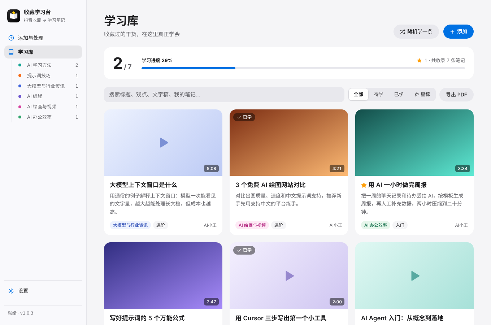
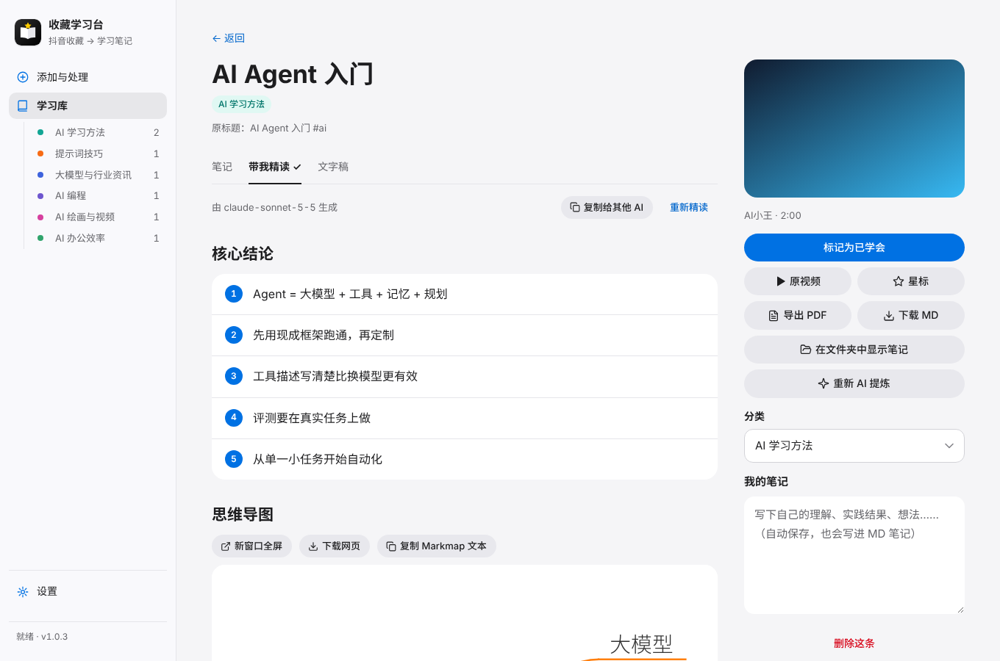
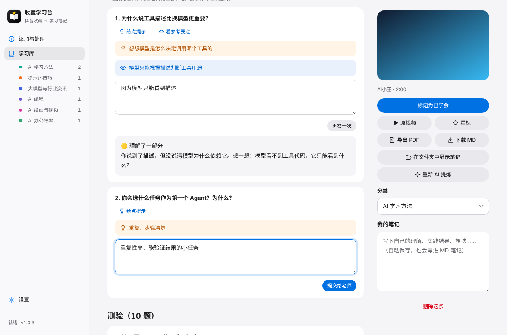
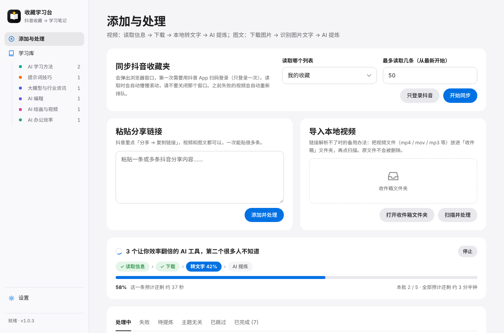
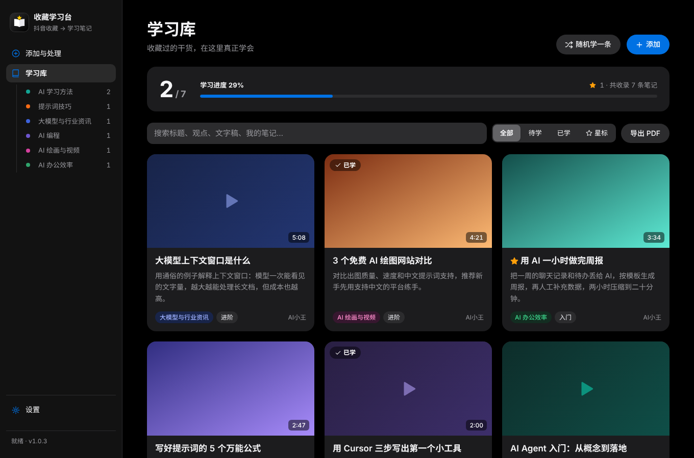

<p align="center"></p>

<h1 align="center">收藏学习台 · Douyin Fav Study</h1>

<p align="center">把抖音收藏的干货视频和图文，变成能学、能测、能复习的本地笔记<br>
Turn your saved Douyin videos &amp; image posts into local study notes you can learn, quiz and review.</p>

<p align="center">


</p>

**抖音链接 / 收藏夹 → 下载 → 本机语音转文字 / 图片文字识别 → AI 提炼 → 学习网站 + Markdown 笔记 + PDF**

- 视频、音频、图片只在你自己的电脑上处理，只有文字会发给你自己选的 AI 服务商
- 用的是你自己的抖音登录和你自己的 AI Key，所有数据都保存在本机
- 笔记是普通的 `.md` 文件，可以直接用 Obsidian、Typora 打开，不会被这个软件锁死

> Everything runs locally on your own machine: your own Douyin login, your own AI key of choice (Claude, DeepSeek, Kimi, Qwen, GLM, SiliconFlow, OpenAI, Gemini or any OpenAI-compatible API, including free tiers). Notes are plain Markdown files. The UI is in Chinese.

## 讲解视频 · Video

https://github.com/user-attachments/assets/00f61aff-8f26-4cbc-a444-ab62e3a569c5

上面是约 50 秒的短版。约 3 分钟的完整版（安装、启动、配置 API、使用）：[下载 douyin-fav-study-intro-full.mp4](https://github.com/yuanshengbo8-sketch/douyin-fav-study/releases/download/v1.0.1/douyin-fav-study-intro-full.mp4)
The full 3-minute walkthrough is attached to the [v1.0.1 release](https://github.com/yuanshengbo8-sketch/douyin-fav-study/releases/tag/v1.0.1).



## 功能一览 · Features

| | |
|---|---|
| **两种添加方式**：粘贴分享链接，或一键同步整个收藏夹 | **视频 + 图文**：视频转文字，图文用本机文字识别 |
| **本机转写**：苹果芯片 Mac 用 mlx-whisper 加速，其他电脑用 faster-whisper；有字幕直接用字幕 | **AI 提炼**：总结、核心观点、照着做、工具、概念、自测题，自动分类 |
| **带我精读**：核心结论、思维导图、带时间戳的大纲、“你真的懂了吗”追问、10 道测验、Anki 卡片、问老师 | **进度条和剩余时间**：按你电脑的实际速度估算 |
| **免费方案**：智谱 GLM / 硅基流动 / Gemini，粘贴 Key 一键配置 | **备份与恢复**：一个 zip 搬家，恢复前自动留底 |
| **知识网络**：有共同关键词的笔记连成图谱；AI 找出多条视频互相印证的共识观点和说法不一致的地方 | **每周周报**：新增、学会、精读、测验、AI 消耗，连续学习几周 |
| **Windows 一键安装包**：内置 Python 和全部组件，双击安装就能用 | |

<table>
<tr>
<td><br><sub>带我精读：核心结论 + 思维导图</sub></td>
<td><br><sub>你真的懂了吗？AI 点评你的回答</sub></td>
</tr>
<tr>
<td><br><sub>每条的进度与剩余时间</sub></td>
<td><br><sub>图文：原图与识别文字对照</sub></td>
</tr>
<tr>
<td><br><sub>免费方案一键配置</sub></td>
<td><br><sub>自动跟随系统深色模式</sub></td>
</tr>
</table>

## 快速开始 · Quick start

**Windows 最省事：** 到 [Releases](../../releases) 下载 `DouyinFavStudy-Setup-版本号.exe`，双击安装，开始菜单和桌面会有「收藏学习台」。安装包里已经带好 Python 和全部组件，不用自己装 Python，也不需要管理员权限。以后升级再装一次新版本就行，笔记和设置不会丢。

> 之前用脚本安装过的老用户：先在旧版「设置 → 备份与恢复」下载完整备份，装好新版后在同一个地方恢复，数据就搬过来了。

**Mac，或者想用脚本安装：**

1. 安装 **Python 3.12**（不要装 3.13 及以上，部分组件还不支持；Windows 安装时勾选「Add python.exe to PATH」）
2. 下载本仓库（右上角 **Code → Download ZIP**，或到 [Releases](../../releases) 下载），解压
3. 双击 `install_windows.bat` 或 `install_mac.command` 安装（只需一次）
4. 双击 `start_windows.bat` 或 `start_mac.command`，浏览器会打开 `http://127.0.0.1:8765`
5. 设置页里配好 AI（可用免费方案），回到「添加与处理」粘贴链接或同步收藏夹

下面是完整的使用说明。

---

## 一、安装（只需要一次）

### 1. 先装 Python

到 https://www.python.org/downloads/ 下载 **Python 3.12**（3.11 也可以）。

> ⚠️ 官网首页默认推荐的是最新版（3.13 或更高），**不要用它**：语音识别等组件还没有支持新版本，会装不上。在下载页往下翻到「Looking for a specific release?」，选 3.12.x。已经装了新版本也没关系，不用卸载，再装一个 3.12 就行，安装脚本会自动选 3.12。

- **Windows**：安装时一定要勾选下方的 **「Add python.exe to PATH」**
- **Mac**：下载 macOS 安装包，一路下一步即可

### 2. 运行安装脚本

| 系统 | 操作 |
|---|---|
| Windows | 双击 `install_windows.bat` |
| Mac | 右键 `install_mac.command` → 打开（第一次需要右键打开，绕过"无法验证开发者"提示）|

会自动安装需要的组件，大约几分钟。先从官方源下载，失败时自动换清华镜像。

> Mac 如果提示"没有权限"，打开「终端」，输入 `bash ` （后面有空格），把 `install_mac.command` 拖进终端窗口，回车即可。

### 3. 浏览器

程序会用你电脑上已有的 **Edge 或 Chrome** 打开抖音（Windows 自带 Edge）。都没有的话，安装脚本会自动下载一个。

---

## 二、启动

处理每条视频时，「添加与处理」页会显示进度条：当前在哪一步、百分比、这一条还剩多久、整批还剩多久。剩余时间按你电脑的实际速度估算，处理几条之后会越来越准。

| 系统 | 操作 |
|---|---|
| Windows | 双击 `start_windows.bat` |
| Mac | 双击 `start_mac.command` |

会弹出一个黑色命令行窗口（**别关它，关掉程序就退出了**），浏览器会自动打开 `http://127.0.0.1:8765`。

---

## 三、第一次使用

### 1. 配置 AI（设置页）

**不想花钱：用「免费方案」**。设置页最上面选一家（国内推荐智谱 GLM 或硅基流动，海外可选 Gemini），按三步操作：注册 → 创建 API Key 并复制 → 粘贴后点「一键配置」。程序会自动测试，并挑一个能用的免费模型。用的是你自己账号的免费额度，不花钱。免费额度用完时会提示你；额度一般按天或按月恢复。

**想要更好的效果：自己选付费模型**，在下面的「AI 提炼」里设置。

选一个 AI 服务商，填入 API Key，点「测试连接」。推荐 **DeepSeek**：便宜，中文好，处理一条视频大约几分钱甚至更少。

支持：Claude（Anthropic）、DeepSeek、Kimi、通义千问、智谱 GLM、硅基流动、OpenAI，以及任何 OpenAI 兼容接口（选"自定义"）。

> 不填 Key 也能用，但只能转成文字，生成不了学习笔记。之后填上 Key，在「添加与处理 → 待提炼」里点「全部提炼」即可补上。

### 2. 设置关注主题（可选）

默认关注 **AI 相关干货**。和主题无关的视频会被自动收起（在「主题无关」里可以找回）。想学理财、健身、英语，直接改这一栏就行。

### 3. 添加视频（三种方式）

**方式一：粘贴分享链接**（最稳定，推荐）
抖音里打开视频 → 分享 → 复制链接，粘贴进来。可以一次粘贴很多条。

**方式二：同步整个收藏夹**
「添加与处理」页 → 同步抖音收藏夹 → 开始同步。
第一次会弹出浏览器窗口，用抖音 App 扫码登录（只需一次）。程序会慢慢往下滚动读取列表，**过程中请不要关闭这个窗口**。可以选「我的收藏」或「我的喜欢」，也可以限制最多读取多少条，建议第一次先读 20 条试试。

**方式三：导入本地视频**（备用）
链接解析不了时，可以先把视频保存到手机或电脑，放进「收件箱」文件夹，再点「扫描并处理」。

### 4. 转文字的速度

- **视频自带字幕**：直接用字幕，不用下载也不用转写，几秒就好。
- **苹果芯片 Mac（M1/M2/M3/M4）**：自动用 Mac 加速版（mlx-whisper large-v3-turbo）。第一次会下载约 1.6GB 模型，之后 1 分钟的视频通常几秒到十几秒就能转完。
- **Windows / Intel Mac**：用通用版（faster-whisper small）。第一次下载约 480MB，1 分钟的视频大约 20 到 60 秒。
- 人在中国大陆时，在设置里勾选「使用国内镜像下载模型」；在海外不要勾。

---

## 四、学习

- **学习库**：所有笔记按分类展示，可以搜索，可以筛选待学 / 已学 / 星标
- **笔记页**：一句话总结、核心观点、照着做的步骤、提到的工具、关键概念、自测题、原文转录
- **标记已学会**：首页的学习进度条会随之更新
- **我的笔记**：写下自己的理解和实践结果，会自动保存，也会同步写进 MD 文件
- **随机学一条**：从还没学的笔记里随机抽一条
- **导出 PDF**：单条或整个列表都可以导出；在打印窗口里选择「另存为 PDF」
- **下载 MD / 在文件夹中显示**：笔记都保存在 `data/知识库/分类/标题.md`，可以把这个文件夹直接当 Obsidian 库打开


### 图文也能学

收藏夹里的**图文笔记**也会一起进学习台：程序会下载所有图片，用本机的文字识别把图上的字认出来（Mac 用苹果系统自带的识别引擎，Windows 用 RapidOCR，都在本机运行，图片不上传），和正文合在一起交给 AI 提炼，后面的分类、精读、测验和视频完全一样。

- 详情页能看原图，点图片放大，左右键翻页；「原图与文字」标签里每张图和识别出的文字并排对照
- 图片保存在笔记目录的 `_图片/` 文件夹，MD 笔记里直接嵌入原图，Obsidian 打开就能看到
- 纯图片、没有文字的图文（摄影、表情包）会自动跳过
- **老用户需要重新运行一次安装脚本**，才会装上文字识别组件

### 带我精读（有人带着读）

每条笔记页里有「带我精读」标签，长视频（两小时以上也行）同样适用。AI 会像老师一样带你读：

- **5 句核心结论** → **思维导图** → **章节大纲**（带时间戳，点击跳到文字稿对应位置）→ **关键概念和术语解释**
- **你真的懂了吗？** 不直接给答案，用问题检查你；你写下回答，AI 点评并继续追问
- **10 道测验题**（点选作答，马上判对错）
- **Anki 卡片**：下载 `.txt`，在 Anki 里「文件 → 导入」，分隔符选 Tab
- 思维导图用 Markmap，可缩放折叠，可下载成网页
- **问老师**：随时追问没看懂的地方
- **复制提示词+文稿**：一键复制，粘贴到豆包 / Kimi / 千问 / Claude 网页版也能用

文稿太长时，会先分段做详细笔记，最后合并再精读，避免超出模型上下文长度。精读结果也会写进 MD 笔记。

**精读可以用更强的模型**：设置 → 精读，取消「和 AI 提炼用同一个模型」，就能单独选 Claude 等。日常批量提炼用便宜的 DeepSeek，精读用 Claude，比较省钱。

### 知识网络：图谱和共识观点

收藏多了，很多视频其实在讲同一件事。左侧「知识网络」把笔记放在一起看：

- **图谱**：两条笔记有共同的标签、概念或工具，就连一条线，共同的越多线越粗。点一个圆点，会高亮和它有关的笔记，右边列出它们共同提到了什么；双击打开笔记。在本机计算，不花钱
- **共识观点**：选一个分类点「整理共识」，AI 会把这个分类的笔记放在一起读，找出**被两条以上视频互相印证的观点**（每条都标出是哪几条视频说的，点一下跳过去），以及**说法不一致的地方**和怎么看待。每个分类调用一次 AI，用「设置 → 精读」里的模型
- 整理好的共识观点会以菱形出现在图谱里，连着支持它的笔记；也会保存成 Markdown，放在笔记文件夹的 `_共识观点/` 里，Obsidian 里能点链接跳回原笔记
- 分类里加了新笔记，卡片上会提示「新增 N 条笔记」，再整理一次就行

### 每周周报

左侧「每周周报」统计这一周（周一到周日）：新增几条笔记、学会几条、精读几条、测验正确率、回答检查题和问老师的次数、AI 用了多少 tokens，新笔记都在学哪些分类、高频关键词，以及「接下来先学这几条」。

- **连续学习周数**：每周至少学一次（标记学会、精读、做测验、回答检查题都算）就加一周
- 新的一周开始后，学习库顶部会提示「上周的学习周报出来了」
- 可以翻看以前的周，也可以「保存为 Markdown」到笔记文件夹的 `_周报/` 里
- 全部在本机统计，不调用 AI

---

## 五、自动跳过和防出错机制

| 情况 | 处理方式 |
|---|---|
| 广告视频、图文笔记 | 读取信息时直接跳过，不下载 |
| 纯音乐、无对白、只有一两句歌词 | 转文字后发现内容太少，跳过，不浪费 AI 费用 |
| 带货、短剧、唱歌跳舞、闲聊 | AI 判断没有实质内容，跳过 |
| 和关注主题无关 | 收进「主题无关」，觉得有用可以一键收回学习库 |
| 同一个视频添加两次 | 自动去重 |
| 下载或网络出错 | 30 秒后自动重试一次，仍失败就放进「失败」，可以手动重试 |
| AI Key 错误、余额不足 | 直接提示原因，不会反复重试扣费 |
| 超长视频 | 只转录前 15 分钟（可在设置中修改）|
| 程序中途被关掉 | 下次启动时，处理到一半的视频会自动回到队列 |

---

## 六、常见问题

**同步收藏夹时没反应 / 读不到？**
看一眼弹出的浏览器窗口：抖音可能弹了滑块验证码，手动完成后重新点同步即可。也可能是登录过期了，点「只登录抖音」重新扫码。

**某条一直失败？**
可能视频被删除或设为私密。也可以把视频下载下来，用「导入本地视频」处理。

**能处理多快？会被封号吗？**
程序会模拟正常浏览速度（滚动和下载之间都有间隔），只读取你自己账号的收藏。不过任何自动化操作都有被平台限制的可能，**建议一次不要处理太多（比如几十条）**，分几天慢慢处理。

**想换一台电脑？**
用「设置 → 备份与恢复」：
1. 旧电脑上点「下载完整备份」，得到一个 `收藏学习台备份-日期.zip`（包含笔记、文字稿、精读、学习进度、设置）。
2. 新电脑上装好学习台（同样运行安装脚本），打开「设置 → 恢复备份…」，选这个 zip，确认后就恢复原样。
3. 抖音登录状态不在备份里，新电脑上重新扫码；语音模型会自动重新下载。

恢复会覆盖当前数据，但恢复前程序会先把当前数据自动备份到 `data/backups/`（保留最近 5 个），在同一个页面可以一键撤销。
备份里如果包含 AI Key，请像密码一样保管。平时也建议隔一段时间下载一次备份，放到 iCloud 云盘或网盘里。

**怎么彻底删除？**
直接删除整个文件夹。删除前记得备份 `data/知识库`，里面是你的笔记。

---

## 文件结构

```
app/            程序代码（Python 后端 + 网页界面）
installer/      Windows 安装包的打包脚本（见下面「自己打包安装包」）
data/           你的数据（首次运行自动创建）
  知识库/        Markdown 笔记（可以用 Obsidian 打开）
    _共识观点/    每个分类整理出的共识观点
    _周报/        保存下来的学习周报
  inbox/        收件箱：放入本地视频
  library.db    处理进度和学习记录
  settings.json 设置（包括你的 AI Key）
  browser/      抖音登录状态
  models/       语音识别模型
```

**注意：** `data/settings.json` 里存着你的 AI Key，`data/browser/` 里存着你的抖音登录状态。如果要把这个软件分享给别人，**一定要先删掉 `data` 文件夹**。

用安装包装的版本，程序和 `data` 都在 `%LOCALAPPDATA%\Programs\DouyinFavStudy\`。卸载时会问要不要一起删掉数据，默认保留。

### 自己打包安装包

装好 [Inno Setup 6](https://jrsoftware.org/isdl.php)，在仓库根目录运行

```
powershell -ExecutionPolicy Bypass -File installer\build_windows.ps1
```

脚本会下载官方嵌入版 Python 3.12、装好全部组件、编译出 `dist\DouyinFavStudy-Setup-版本号.exe`。国内网络慢可以加 `-PipIndex https://pypi.tuna.tsinghua.edu.cn/simple`。

想让 GitHub 在每次发布 Release 时自动打包：把 `installer/windows-installer.yml` 移到 `.github/workflows/` 里再推送（推送 workflow 文件需要 GitHub 账号授权 `workflow` 权限，命令行用户先运行 `gh auth refresh -s workflow`）。

---

## 隐私与安全 · Privacy

- 服务只监听本机 `127.0.0.1`，不对局域网和外网开放
- `data/` 文件夹里有你的 AI Key 和抖音登录状态，已写进 `.gitignore`。**不要上传、分享或提交这个文件夹**
- 发给 AI 服务商的只有文字稿和标题，不含视频、音频和图片

## 免责声明 · Disclaimer

本项目仅供个人学习和整理**自己收藏**的内容使用。请遵守抖音的用户协议，尊重创作者的版权：生成的笔记只供自己学习，不要批量搬运、二次发布或用于商业用途。本项目与抖音、字节跳动没有任何关系。自动化操作有被平台限制的风险，请适度使用，风险由使用者自行承担。

This project is for personal study of content you saved yourself. Respect Douyin's Terms of Service and creators' copyright. Not affiliated with Douyin or ByteDance. Use at your own risk.

## 许可证 · License

[PolyForm Noncommercial 1.0.0](LICENSE.md)：可以免费使用、修改和分享，**但不能用于商业用途**。个人、学生、研究、公益和教育机构使用都没问题。如需商用授权，请开 Issue 联系。

Free for personal, research, educational and other noncommercial use. Commercial use requires separate permission. Note: this is a source-available license, not an OSI-approved open-source license.

更新记录见 [CHANGELOG.md](CHANGELOG.md)。
